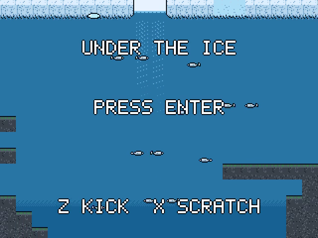
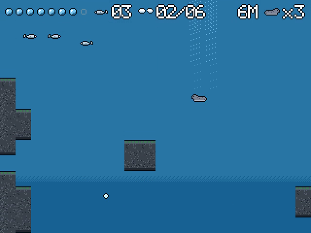
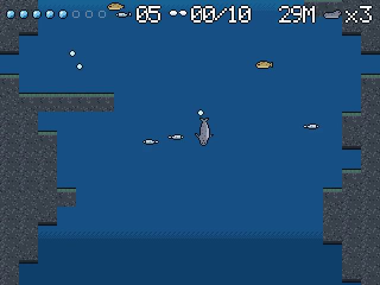

# Under the Ice

Dive through holes in drifting ice, catch fish and return to the surface before your air runs out. Bank your catch for stronger flippers and bigger lungs as the dives grow deeper.

For the Zeal 8-bit computer with the Video Board, running Zeal 8-bit OS.

  

## Controls

Menu prompts default to a connected SNES pad and follow the last device used
in the menu. The selected keyboard/pad display stays fixed during the game.

| Action | Keyboard | SNES pad |
|---|---|---|
| Swim in 8 directions | Arrows | D-pad |
| Flipper kick (burst of speed) | Z or Space | B |
| Scratch at thin ice from below | X (hold) | A |
| Pause | Enter | Start |
| Quit to title | Right Shift | Select |

Enter starts the game on the title screen. After a dive, Left buys bigger lungs and Right faster flippers.

## How to play

- Find an ice hole, dive and catch fish.
- Return to a hole for air; drifting ice means it may have moved.
- Bank fish at the surface and upgrade your equipment for deeper dives.

## Build

Install the Zeal Development Environment (ZDE) and its SDK dependencies, then run
these commands from this repository:

```sh
zde deps install zgdk
zde cmake
```

The build produces `bin/underice.bin`.
Use a current ZGDK installation with inertial-controller support.

## Run

For Zeal-NativeEmulator, mount the output folder as HostFS:

```sh
zeal-native -r /path/to/os_with_romdisk.img -H bin
```

At the ZOS prompt:

```text
cd H:/
exec underice.bin
```

On hardware, copy the `.bin` to your target disk and run it with `exec`.

Build variants, asset editing and optional development tools are documented in
[the development guide](docs/development.md).

## License

Copyright 2026 David Higgins. Game code and original assets are licensed under
[Apache License 2.0](LICENSE). External SDKs and tools retain their own licenses.
